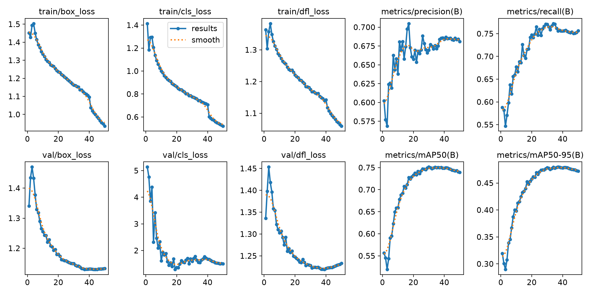
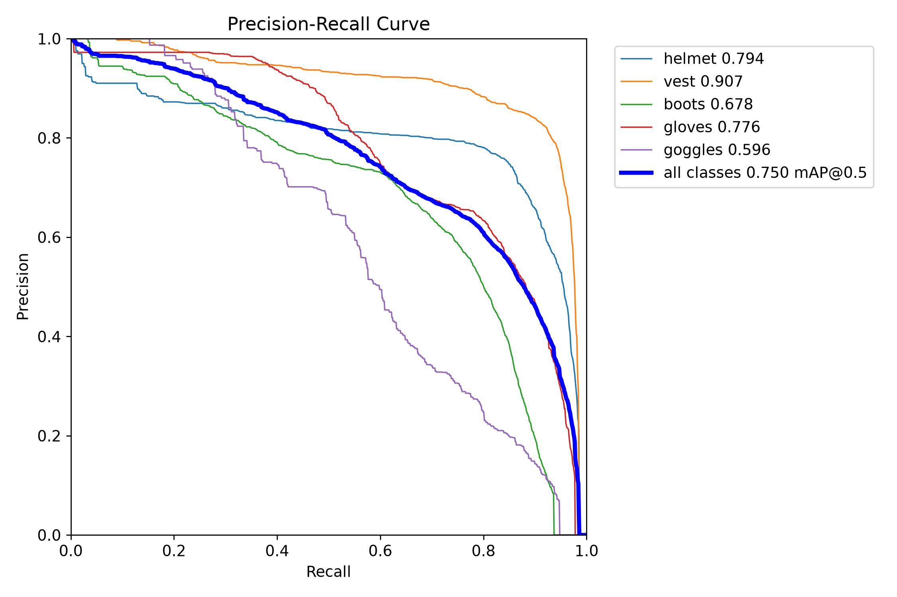
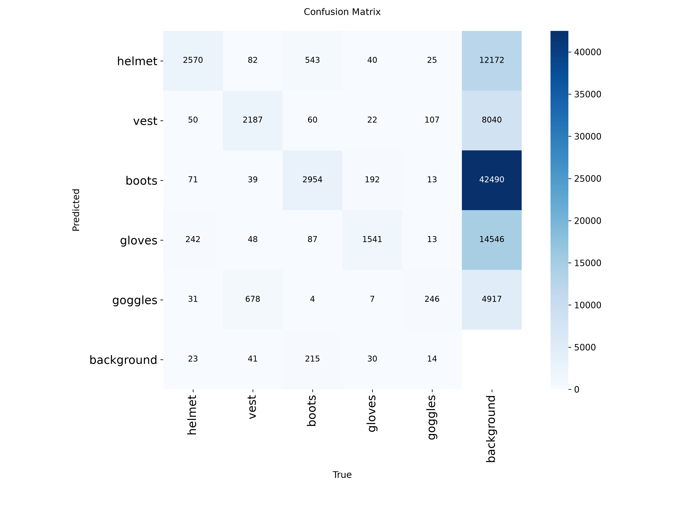
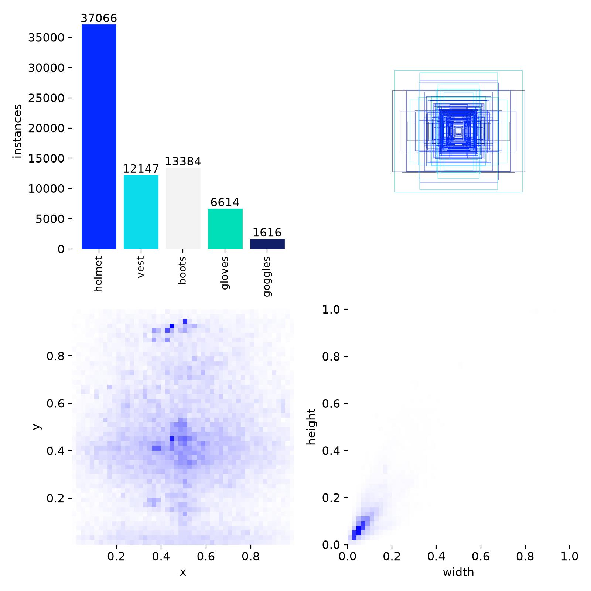

# 🛡️ PPE Audit & Monitoring System (YOLOv8 + SAHI)

[](https://yolov8-safety-equipment-detection-qsj9ufsc4gezwsv7v3t9ms.streamlit.app/)
[](https://www.python.org/)
[](https://ultralytics.com/)

An enterprise-grade industrial safety inspection web application designed to automatically detect Personal Protective Equipment (PPE), evaluate OHS (Occupational Health and Safety) compliance using spatial reasoning, and provide bilingual analytics.

---

## 🚀 Key Features & Capabilities

* **Multiclass Detection (5 Classes):** Accurately detects Helmets (`helmet`), Safety Vests (`vest`), Safety Boots (`boots`), Gloves (`gloves`), and Goggles (`goggles`).
* **Gigapixel SAHI Mode:** Integrates *Slicing Aided Hyper Inference* (SAHI) to slice high-resolution photographs into localized tiles, overcoming object scaling issues and detecting tiny accessories or distant workers.
* **Smart OHS Compliance Engine:** Employs spatial intersection logic between safety helmets and vests, combined with adaptive distance filtering to eliminate background false positives.
* **Adaptive Auto Sensitivity:** Automatically computes confidence floors per photo based on maximum score distributions to adjust detection thresholds dynamically.
* **Bilingual Interface (i18n):** Instant live switching between English and Spanish via an accessible sidebar control.
* **CSV Audit Export:** Real-time generation and instant download of compliance audit reports.

---

## 🛠️ Tech Stack & Architecture

* **Core Framework:** Python 3.10+, Streamlit
* **Computer Vision & AI:** Ultralytics YOLOv8 Medium (`best.pt`), SAHI (Slicing Aided Hyper Inference)
* **Image Processing & Data:** OpenCV, Pillow, Pandas, NumPy

---

## 📊 Model Training & Performance Metrics

The underlying model was trained using **YOLOv8 Medium** over a specialized industrial dataset containing multi-class bounding box annotations for safety equipment.

### 📈 Training Results & Loss Convergence

*Figure 1: Training and validation loss curves (box, cls, dfl) alongside mAP50 and mAP50-95 metrics showing stable model convergence.*

### 🎯 Precision-Recall Curves (mAP@0.5)

*Figure 2: Precision-Recall curves evaluated across all target classes, achieving a strong overall mAP@0.5.*

### 🔍 Confusion Matrix

*Figure 3: Confusion matrix detailing true positives versus class-wise misclassifications and background confusion.*

### 📦 Dataset Distribution & Spatial Layout

*Figure 4: Instance count distribution per class and bounding box spatial heatmaps showing target distribution.*

---

## 📦 Quick Start & Installation

1. **Clone the repository:**
   ```bash
   git clone https://github.com/MarketablePlushiee/yolov8-safety-equipment-detection.git
   cd yolov8-safety-equipment-detection
   ```

2. **Install required dependencies:**
   ```bash
   pip install -r requirements.txt
   ```

3. **Run the Streamlit application:**
   ```bash
   streamlit run app.py
   ```

---
---

# 🛡️ Sistema de Auditoría y Monitoreo de EPP (YOLOv8 + SAHI)

Aplicación web de inspección de seguridad industrial de nivel profesional diseñada para detectar automáticamente Equipos de Protección Personal (EPP), evaluar el cumplimiento de SST mediante lógica espacial y ofrecer análisis bilingües.

---

## 🚀 Características y Capacidades Principales

* **Detección Multiclase (5 Clases):** Detecta con precisión Cascos (`helmet`), Chalecos reflectantes (`vest`), Botas de seguridad (`boots`), Guantes (`gloves`) y Gafas de protección (`goggles`).
* **Modo SAHI Gigapixel:** Integra *Slicing Aided Hyper Inference* (SAHI) para fragmentar fotos de alta resolución en teselas locales, superando problemas de escala y detectando accesorios pequeños o trabajadores lejanos.
* **Motor Inteligente de Cumplimiento SST:** Utiliza lógica de intersección espacial entre cascos y chalecos, combinada con un filtrado de distancia adaptativo para eliminar falsas alarmas en fondos lejanos.
* **Sensibilidad Automática Adaptativa:** Calcula dinámicamente umbrales de confianza por fotografía según la distribución de puntajes máximos.
* **Interfaz Bilingüe (i18n):** Alternancia en vivo e instantánea entre español e inglés desde un selector destacado en la barra lateral.
* **Exportación de Auditoría CSV:** Generación en tiempo real y descarga instantánea de reportes de cumplimiento.

---

## 🛠️ Tecnologías y Arquitectura

* **Framework Principal:** Python 3.10+, Streamlit
* **Visión por Computadora e IA:** Ultralytics YOLOv8 Medium (`best.pt`), SAHI (Slicing Aided Hyper Inference)
* **Procesamiento de Imagen y Datos:** OpenCV, Pillow, Pandas, NumPy

---

## 📊 Entrenamiento del Modelo y Métricas de Rendimiento

El modelo subyacente fue entrenado utilizando **YOLOv8 Medium** sobre un dataset industrial especializado con anotaciones de cajas delimitadoras multiclase para equipos de seguridad.

### 📈 Resultados de Entrenamiento y Convergencia de Pérdidas

*Figura 1: Curvas de pérdida de entrenamiento y validación junto con las métricas mAP50 y mAP50-95 demostrando una convergencia estable.*

### 🎯 Curvas de Precisión-Exhaustividad (mAP@0.5)

*Figura 2: Curvas de Precisión-Recall evaluadas en todas las clases objetivo, logrando un sólido mAP@0.5 general.*

### 🔍 Matriz de Confusión

*Figura 3: Matriz de confusión que detalla los aciertos frente a las clasificaciones erróneas por clase.*

### 📦 Distribución del Dataset y Disposición Espacial

*Figura 4: Distribución del recuento de instancias por clase y mapas de calor espaciales de las cajas delimitadoras.*

---

## 📦 Inicio Rápido e Instalación

1. **Clona el repositorio:**
   ```bash
   git clone https://github.com/MarketablePlushiee/yolov8-safety-equipment-detection.git
   cd yolov8-safety-equipment-detection
   ```

2. **Instala las dependencias requeridas:**
   ```bash
   pip install -r requirements.txt
   ```

3. **Ejecuta la aplicación de Streamlit:**
   ```bash
   streamlit run app.py
   ```

---

## 👨‍💻 Developer / Desarrollador

* **Ivan Latrille Brito** — *Universidad Bernardo O'Higgins*
* **Live App:** [Streamlit Cloud Deployment](https://yolov8-safety-equipment-detection-qsj9ufsc4gezwsv7v3t9ms.streamlit.app/)
* **Portfolio:** [marketableplushiee.github.io/Portafolio](https://marketableplushiee.github.io/Portafolio/)
